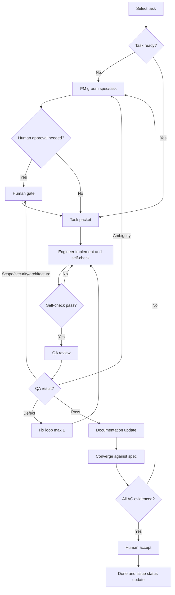

# Development Workflow

**Status:** Initial baseline.  
**Scope:** Development-time agents only. The product's MVP AI assistant remains a single tool-calling agent.

## 1. Principles

- Start with a linear workflow. Add parallel work only when tasks are genuinely independent.
- Specs are the contract; tasks are execution units.
- Evidence over claims: no "tests pass" without commands and results.
- Human authority at consequential decisions.
- Minimal context: read `AGENTS.md`, the task packet, and only referenced docs.

## 2. Roles

| Role | Mission | Required inputs | Output artifact |
|---|---|---|---|
| Human product owner | Approves scope, decisions, costs, and final acceptance | Specs, decision requests, QA summary | Approval or decision |
| Orchestrator | Selects tasks, assembles packets, routes work, enforces limits | Issue tracker, decisions, evidence | Issue status and evidence-based report |
| PM | Clarifies requirements, writes specs/tasks, checks readiness | PRD/SRS, decisions, feedback | Spec and task packet |
| Engineer | Implements one approved task with tests | Task packet, relevant docs/code | Implementation report |
| QA | Independently verifies acceptance criteria and invariants | Task/spec, diff, test instructions | QA report |
| Documentation | Updates affected docs after accepted changes | Task, diff, decisions | Docs report |

Role prompts must not duplicate repository rules. They reference this file and `AGENTS.md`. Every role in the table has a prompt in `team/` (`orchestrator.md`, `pm.md`, `engineer.md`, `qa.md`, `documentation.md`); the human product owner is the only role without one.

## 3. Workflow graph

Terminal states: `Done`, `Blocked`, `Escalated`, `Cancelled`. A task may not move to `Done` without evidence.

## 4. State and artifacts

| Artifact | Location | Owner |
|---|---|---|
| Spec | `docs/PRD.md`, `docs/SRS.md`, or `docs/specs/<feature>.md` | PM |
| Task packet | GitHub issue body groomed from `docs/TASK_TEMPLATE.md` (D-026) | PM/Orchestrator |
| Implementation report | Issue comment (format in `team/engineer.md`) | Engineer |
| QA report | Issue comment (format in `team/qa.md`) | QA |
| Docs report | Issue comment (format in `team/documentation.md`) | Documentation |
| Decisions | `docs/DECISIONS.md` | Product owner |

The issue body is the spec written by the PM; engineer and QA never edit it and post comments instead. The PR description stays short and links the issue; evidence is not duplicated there.

Evidence must include exact commands, outputs, AC mapping, and known limitations. Do not rely on chat summaries alone.

### 4.1 Issue lifecycle (tracker active, D-026)

GitHub Issues carries task status; docs never duplicate it.

| State | Label | Set by |
|---|---|---|
| Proposed | `proposed` | Orchestrator (issue seeded) |
| Ready | `ready` | PM (packet complete, DoR satisfied) |
| In progress | `in-progress` | Orchestrator (branch `issue-<n>` created; set again when a QA defect goes back to the engineer) |
| In QA | `in-qa` | Engineer (implementation report comment posted) |
| Blocked | `blocked` | any role (missing decision or dependency) |
| Done | closed | product owner merges the PR (`Closes #n`) after QA PASS and the docs update |

After QA PASS the orchestrator removes `in-qa` and opens the PR. An open PR linked to the issue means it is awaiting acceptance; there is no separate label for that.

## 5. Loop contracts

| Loop | Goal | Allowed actions | Evidence | Stop condition | Escalate when |
|---|---|---|---|---|---|
| Orchestrator | Move one task to accepted | Select, delegate, route, update status | Task report plus QA report | Issue queue empty, budget reached, or human stop | Conflicting requirements, repeated failure, missing decision |
| Engineer | Satisfy acceptance criteria | Edit code/docs, run tests/lint/type checks | AC-to-test mapping and command output | All AC pass and checks pass | Ambiguity, missing decision, one failed fix cycle, architecture change |
| QA | Independently verify the task | Review, run checks, report missing regression tests as findings (QA changes no code) | Criteria-by-criteria result and findings | Pass, or fail with reproducible evidence | Requirement ambiguity, security/data-integrity risk, scope conflict |
| Documentation | Keep docs consistent with accepted behavior | Edit only affected docs | Diff and source evidence | Docs updated and consistent | Contradiction or undocumented decision |

Limits: maximum one automatic fix/QA cycle before human escalation; maximum two QA attempts per task. Do not retry indefinitely. Adjust limits only with evidence.

## 6. Routing table

| Condition | Next node | Owner |
|---|---|---|
| Task is ambiguous or lacks testable AC | Groom | PM |
| Required decision is unresolved | Decision log and human gate | Product owner |
| Scope, external cost, provider terms, security, privacy, or architecture changes | Human gate | Product owner |
| Self-check fails | Implement/fix | Engineer |
| QA finds an implementation defect | Fix loop (max 1) | Engineer |
| QA finds requirement ambiguity | Groom | PM |
| QA passes | Documentation | Documentation |
| Docs updated but AC evidence is incomplete | Converge/groom | Orchestrator/PM |
| Docs updated and every AC evidenced | Open PR with `Closes #n` | Orchestrator, then the product owner merges |
| Branch conflicts with `main` | Mark `blocked` and comment | Product owner decides |
| Budget or retry limit exhausted | Escalate | Human |
| Unrelated defect found | New issue or blocker | Orchestrator |

## 7. Human gates

Require human approval for:

- New feature or product-scope changes.
- External costs, provider terms, or retention changes.
- Authentication, authorization, privacy, or security-sensitive changes.
- Data-model changes affecting historical comparability or immutability.
- Architecture changes with broad impact.
- Destructive or irreversible actions.
- Final task acceptance (merging the PR).

Routine low-risk tasks may proceed under pre-approved backlog rules.

## 8. Definition of Ready and Done

A task is **Ready** when:

- Scope, non-goals, and acceptance criteria are explicit and testable.
- Dependencies and related decisions are resolved.
- Every acceptance criterion can be checked from a result, and edge and failure cases are listed.
- Relevant specs, docs, and contracts are linked.
- Security, authorization, and data-integrity impact are identified.

A task is **Done** when it satisfies the canonical Definition of Done in `AGENTS.md` and:

- QA independently reviewed non-trivial work.
- The converge step confirms every acceptance criterion has evidence.
- Backlog status and the decision log are updated.

## 9. Model routing

- Use explicit per-role defaults; start with capable models for PM, Engineer, and QA, and a faster model for routine documentation.
- Escalate only on evidence: tool-calling/structured-output failure, repeated acceptance-criteria misses, a substantive reasoning defect, or stalled debugging.
- Fix ambiguous tasks and missing context before spending on a stronger model.
- QA failure does not automatically mean "use a bigger model." Inspect the finding first.
- Record the model/provider used for meaningful invocations.
- Specific assignments, 9Router configuration, fallback behavior, and budgets are deferred to D-023 and D-024, which are deferred decisions and gate no task.

## 10. Subagent runtime

Adopted model (D-025): worktree/branch-per-issue. The orchestrator creates one git worktree and branch `issue-<n>` per task, with its own dependency environments and database, and runs each role as a separate session or subagent with fresh context. Engineers commit and push only their own branch. QA verifies a detached worktree at the pushed commit and posts PASS/FAIL verdicts with evidence as issue comments. Nobody rebases, merges, force-pushes, or deletes: on a conflict with `main` the role comments on the issue, the issue is marked `blocked`, and the product owner decides. After QA PASS and the docs update the orchestrator opens the PR (`Closes #n`); the product owner merges it, which is final acceptance and closes the issue. Destructive commands stop the run until a human approves.

### Role prompts and tools

Role prompts live only in `team/` and are tool-agnostic. To run a role in a specific tool (opencode, Claude Code, or another), add a thin wrapper in that tool's agent directory. Its body only tells the agent to read `team/<role>.md` and `AGENTS.md` first; its frontmatter holds tool-specific settings (description, mode, model, permissions). Never copy role instructions into a wrapper.

**Tool in use: opencode** (record the exact version here once installed: `opencode --version`). Wrappers live in `.opencode/agent/<role>.md` and the shared settings in `opencode.json`. The orchestrator is the only `primary` agent and is the default: the person talks to it, and it launches `pm`, `engineer`, `qa`, and `documentation` as `subagent`s through the task tool. The orchestrator's `task` permission lists exactly those four. The `permission` blocks in the wrappers implement the table below; if they disagree with it, the table wins and the wrapper is a defect. Verify the wrapper syntax against the installed version before the first run, and treat a permission that does not block what it claims as a finding.

Known limits of tool-enforced permissions: `gh issue edit` cannot be restricted to labels only, so "engineer and QA never edit the issue body" is enforced by the `--add-label` and `--remove-label` patterns plus the role prompt. QA needs edit permission to break something on purpose, so "leave no file changed" is verified by `git status` and `git diff HEAD` being empty, not by the tool.

### Permissions per role

Mirror these in any tool's configuration, so the limits are enforced by the tool and not only requested in prose.

| Role | May | Must not |
|---|---|---|
| Orchestrator | Create worktrees and branches, start roles, change labels, comment, open PRs | Edit code, specs, or issue bodies; merge, rebase, force-push, close issues, delete anything |
| PM | Edit issue bodies, create follow-up issues, set `ready` or `blocked`, comment | Write or run code |
| Engineer | Edit and run code in its worktree, commit, push its own branch, comment, set `in-qa` or `blocked` | Edit the issue body; merge, rebase, force-push, delete, touch other branches |
| QA | Read the repo, run checks, break something temporarily to prove a test catches it, comment verdicts, set `blocked` | Commit or push; leave any file changed; delete anything |
| Documentation | Edit docs in the task's worktree, commit and push the task branch, comment | Change code, scope, requirements, or acceptance criteria; merge, rebase, force-push |
| Product owner | Everything above; merge PRs, resolve decisions, remove worktrees and branches | |

### Isolation per worktree

Everything stateful is isolated per worktree: database name, cache or queue namespace (for example the Redis database or a key prefix), and ports. Worktrees live in `../wt/<n>`, branch `issue-<n>`, created from `main`.

- **Shell variables shadow `.env`.** A real environment variable beats the `.env` loader. If the terminal that launched the session exports `DATABASE_URL` (or a Redis URL or a port), it silently puts every worktree back on one database. Defend twice: run commands with the worktree's database named explicitly, and have the worktree's environment pin its own values before the application starts (the reference project does this with an untracked `sitecustomize.py` in the worktree's `.venv`). The pin must stand down inside a container, where Compose sets the variables on purpose.
- **Verify before an agent starts.** One command prints the worktree's own database name, Redis namespace, and ports. The orchestrator runs it and does not start a role until the output names this worktree. A mysterious failure is not where isolation problems should first show up.
- **One agent per worktree at a time, one suite at a time inside it.** Two runs share one test database and drop it under each other, and the failures look like a real regression. Before starting a run, confirm none is alive in that worktree (`pgrep -af pytest`). A run that fails in a strange, scattered way is repeated once, alone and clean, before it is believed. An engineer commits and pushes and is finished before QA is pointed at the same worktree.
- **A role stays inside its own worktree.** The orchestrator gives each role its worktree path. Reading `main` is fine; writing to it or to another worktree is not. A subagent starts in the main checkout's directory, so the path is part of its instructions, not something it can discover.
- **Nothing is dropped.** Databases are never dropped or recreated under the same name: if a name is taken, create a fresh one. Worktrees, branches, and databases stay in place after an issue closes; the product owner removes them.
- **The mechanism is a task deliverable.** T-002 delivers `scripts/new-worktree.sh <n>` (creates the worktree and branch, installs dependencies, copies `.env` and points it at the worktree's own database, Redis namespace, and ports) and `scripts/check-worktree.sh <n>` (the verification command above), and records both in `AGENTS.md`. The orchestrator is allowed to run exactly these two scripts plus `git worktree add`. Until T-002 exists there is no database or other stateful service to isolate, so a plain `git worktree add` is enough and the scripts and the verification step do not apply. A task that needs a database, queue, or port must not start before T-002 has delivered the scripts.

### Before merging

QA's verdict applies to the pushed commit. If `main` moved after QA PASS, re-run the checks on the merged result before merging. The `ci` check documented in [`README.md`](../README.md#continuous-integration) must pass on the pull request.

### Parallel waves (not in use)

The orchestrator runs one task at a time. If the product owner enables parallel work, a task may enter a wave only when every issue it depends on is closed and merged, no other task in the wave changes the same schema or touches the same shared files (settings, routing, `AGENTS.md`, `.env.example`, base templates), and the orchestrator has read its Implementation notes. A wave is only as large as the backlog's independent work; do not pad it to a number.
