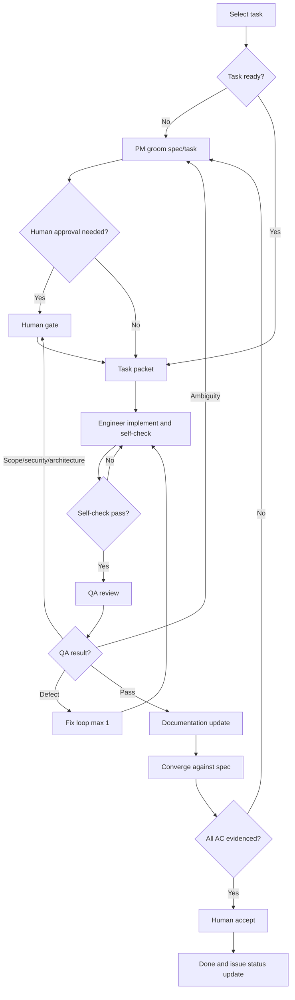

# Development Workflow

**Status:** Initial baseline.  
**Scope:** Development-time agents only. The product's MVP AI assistant remains a single tool-calling agent.

## 1. Principles

- Start with a linear workflow. Add parallel work only when tasks are genuinely independent.
- Specs are the contract; tasks are execution units.
- Evidence over claims: no "tests pass" without commands and results.
- Human authority at consequential decisions.
- Minimal context: read `AGENTS.md`, the task packet, and only referenced docs.

## 2. Roles

| Role | Mission | Required inputs | Output artifact |
|---|---|---|---|
| Human product owner | Approves scope, decisions, costs, and final acceptance | Specs, decision requests, QA summary | Approval or decision |
| Orchestrator | Selects tasks, assembles packets, routes work, enforces limits | Issue tracker, decisions, evidence | Issue status and evidence-based report |
| PM | Clarifies requirements, writes specs/tasks, checks readiness | PRD/SRS, decisions, feedback | Spec and task packet |
| Engineer | Implements one approved task with tests | Task packet, relevant docs/code | Implementation report |
| QA | Independently verifies acceptance criteria and invariants | Task/spec, diff, test instructions | QA report |
| Documentation | Updates affected docs after accepted changes | Task, diff, decisions | Docs report |

Role prompts must not duplicate repository rules. They reference this file and `AGENTS.md`. Every role in the table has a prompt in `team/` (`orchestrator.md`, `pm.md`, `engineer.md`, `qa.md`, `documentation.md`); the human product owner is the only role without one.

## 3. Workflow graph

Terminal states: `Done`, `Blocked`, `Escalated`, `Cancelled`. A task may not move to `Done` without evidence.

## 4. State and artifacts

| Artifact | Location | Owner |
|---|---|---|
| Spec | `docs/PRD.md`, `docs/SRS.md`, or `docs/specs/<feature>.md` | PM |
| Task packet | GitHub issue body groomed from `docs/TASK_TEMPLATE.md`, seeded from `docs/TASKS.md` (D-026) | PM/Orchestrator |
| Implementation report | Task completion report or PR description | Engineer |
| QA report | Task completion report or PR review | QA |
| Docs report | Task completion report or PR description | Documentation |
| Decisions | `docs/DECISIONS.md` | Product owner |

Evidence must include exact commands, outputs, AC mapping, and known limitations. Do not rely on chat summaries alone.

### 4.1 Issue lifecycle (tracker active, D-026)

GitHub Issues carries task status; docs never duplicate it. Until tracker activation, statuses live in completion reports.

| State | Label | Set by |
|---|---|---|
| Proposed | `proposed` | Orchestrator (issue seeded) |
| Ready | `ready` | PM (packet complete, DoR satisfied) |
| In progress | `in-progress` | Engineer (branch `issue-<n>` exists) |
| In QA | `in-qa` | Engineer (implementation report comment posted) |
| Blocked | `blocked` | any role (missing decision or dependency) |
| Done | closed | human acceptance after QA PASS and docs update |

## 5. Loop contracts

| Loop | Goal | Allowed actions | Evidence | Stop condition | Escalate when |
|---|---|---|---|---|---|
| Orchestrator | Move one task to accepted | Select, delegate, route, update status | Task report plus QA report | Issue queue empty, budget reached, or human stop | Conflicting requirements, repeated failure, missing decision |
| Engineer | Satisfy acceptance criteria | Edit code/docs, run tests/lint/type checks | AC-to-test mapping and command output | All AC pass and checks pass | Ambiguity, missing decision, one failed fix cycle, architecture change |
| QA | Independently verify the task | Review, run checks, report missing regression tests as findings (QA changes no code) | Criteria-by-criteria result and findings | Pass, or fail with reproducible evidence | Requirement ambiguity, security/data-integrity risk, scope conflict |
| Documentation | Keep docs consistent with accepted behavior | Edit only affected docs | Diff and source evidence | Docs updated and consistent | Contradiction or undocumented decision |

Limits: maximum one automatic fix/QA cycle before human escalation; maximum two QA attempts per task. Do not retry indefinitely. Adjust limits only with evidence.

## 6. Routing table

| Condition | Next node | Owner |
|---|---|---|
| Task is ambiguous or lacks testable AC | Groom | PM |
| Required decision is unresolved | Decision log and human gate | Product owner |
| Scope, external cost, provider terms, security, privacy, or architecture changes | Human gate | Product owner |
| Self-check fails | Implement/fix | Engineer |
| QA finds an implementation defect | Fix loop (max 1) | Engineer |
| QA finds requirement ambiguity | Groom | PM |
| QA passes | Documentation | Documentation |
| Docs updated but AC evidence is incomplete | Converge/groom | Orchestrator/PM |
| Budget or retry limit exhausted | Escalate | Human |
| Unrelated defect found | New issue or blocker | Orchestrator |

## 7. Human gates

Require human approval for:

- New feature or product-scope changes.
- External costs, provider terms, or retention changes.
- Authentication, authorization, privacy, or security-sensitive changes.
- Data-model changes affecting historical comparability or immutability.
- Architecture changes with broad impact.
- Destructive or irreversible actions.
- Final task acceptance.

Routine low-risk tasks may proceed under pre-approved backlog rules.

## 8. Definition of Ready and Done

A task is **Ready** when:

- Scope, non-goals, and acceptance criteria are explicit and testable.
- Dependencies and related decisions are resolved.
- The test plan maps acceptance criteria to checks.
- Relevant specs, docs, and contracts are linked.
- Security, authorization, and data-integrity impact are identified.

A task is **Done** when it satisfies the canonical Definition of Done in `AGENTS.md` and:

- QA independently reviewed non-trivial work.
- The converge step confirms every acceptance criterion has evidence.
- Backlog status and the decision log are updated.

## 9. Model routing

- Use explicit per-role defaults; start with capable models for PM, Engineer, and QA, and a faster model for routine documentation.
- Escalate only on evidence: tool-calling/structured-output failure, repeated acceptance-criteria misses, a substantive reasoning defect, or stalled debugging.
- Fix ambiguous tasks and missing context before spending on a stronger model.
- QA failure does not automatically mean "use a bigger model." Inspect the finding first.
- Record the model/provider used for meaningful invocations.
- Specific assignments, 9Router configuration, fallback behavior, and budgets are deferred to D-023 and D-024.

## 10. Subagent runtime

Adopted model (D-025): worktree/branch-per-issue. The orchestrator provisions one git worktree, branch `issue-<n>`, and environment/database per engineer/QA session. Engineers implement, commit, and push only their own branch; they never merge, rebase main, or touch another branch (the orchestrator rebases; never force-push). QA verifies a single dedicated worktree and posts PASS/FAIL verdicts with evidence as issue comments. Destructive commands stop the run until a human approves.

Role prompts currently live in `team/`. If using opencode subagents directly, mirror them under `.opencode/agent/<name>.md` with frontmatter and permissions, referencing this workflow and `AGENTS.md` — never a second copy of role instructions.
